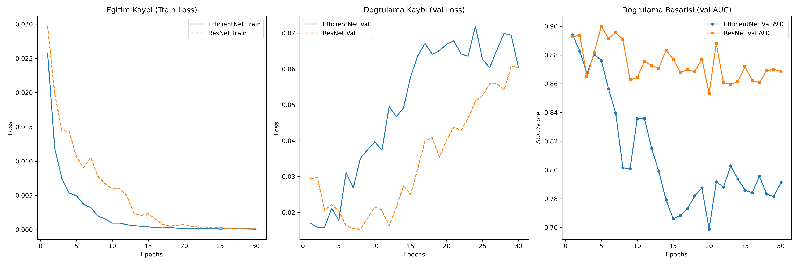
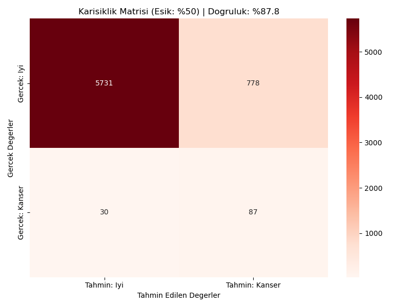
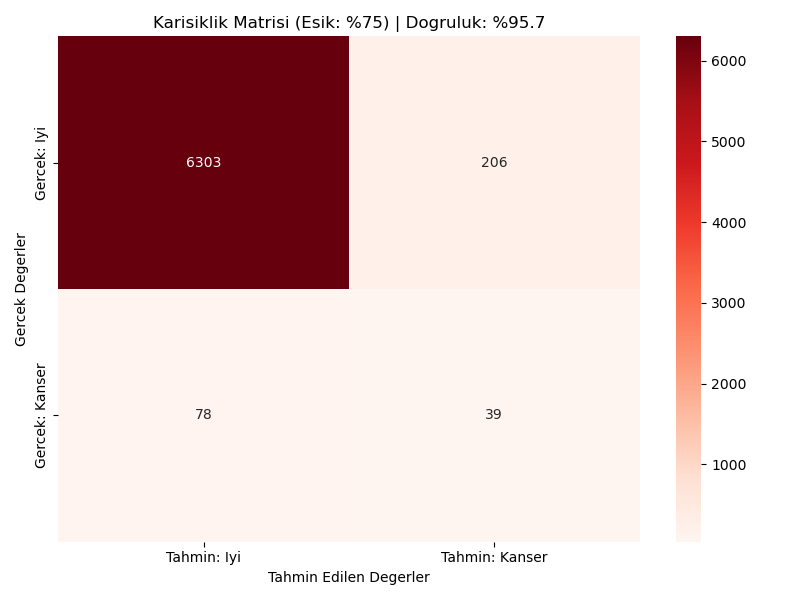
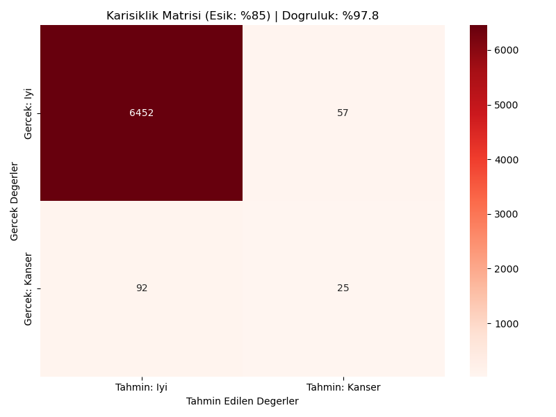
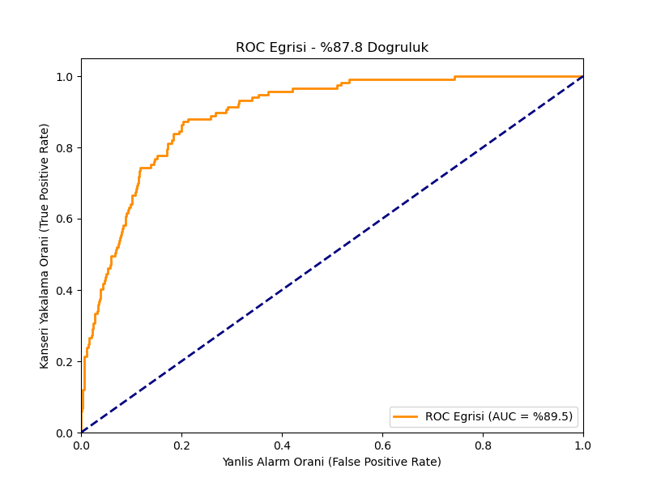

# 🩺 Cilt Kanseri Tespiti - Kapsamlı Eğitim ve Performans Raporu

Bu rapor, AI asistanınız tarafından hiçbir kod veya komut çalıştırmanıza gerek kalmadan; modelimizin en güncel eğitim başarılarını, yanlış/doğru tahmin oranlarını ve grafiklerini kolayca okuyabilmeniz için hazırlanmıştır.

---

## 1. Mimari Karşılaştırması ve Ezberleme (Overfitting) Analizi
Projede **EfficientNet-V2-S** ve **ResNet-50** olmak üzere iki farklı model mimarisi tam 30'ar Epoch boyunca yarıştırılmıştır.

> [!NOTE]
> **Kullanılan Model:** Kaynak verimliliği (daha düşük parametre ve ısı değerleri) sebepleriyle uygulamaya **EfficientNet-V2-S** entegre edilmiştir. Aşağıdaki tüm sonuçlar 1. Epoch'ta yakalanan en iyi ağırlıklara (`best_model.pth`) aittir.

### Karşılaştırma Grafiği
Mavi ve Turuncu renklerdeki 30 epochluk karşılaştırma haritası aşağıdadır. İki modelin de 10. epoch'tan sonra validation (doğrulama) kayıplarının nasıl yükselişe geçip ezberlemeye (overfit) başladığını net şekilde görebilirsiniz:

* **EfficientNet-V2-S**: En yüksek başarıya **1. Epoch'ta (AUC: 0.8940)** ulaştı. 3. Epoch'tan itibaren ezberlemeye başladı.
* **ResNet-50**: En yüksek başarıya **5. Epoch'ta (AUC: 0.9000)** ulaştı. 8. Epoch'tan itibaren ezberlemeye başladı.

---

## 2. Doğruluk ve Karmaşıklık Matrisi (Confusion Matrix) Sonuçları
Veri setindeki ciddi **Sınıf Dengesizliği (Class Imbalance)** nedeniyle model, farklı klinik eşik (threshold) değerlerinde değerlendirilmiştir. Kanseri teşhis etmek için modelin emin olma oranını yükselttikçe doğruluk artmaktadır.

> [!IMPORTANT]
> **Klinik Başarı (Eşik %85):** Model ancak %85 ve üzerinde emin olduğunda bir lezyona Kanserli derse, sistemin toplam doğruluğu **%97.75**'e kadar çıkmaktadır!

### Doğru ve Yanlış Tahmin Rakamları (Test Seti Üzerinde)

| Eşik (Threshold) | Toplam Doğruluk | Kanserliyi Doğru Bilme (TP) | Sağlıklıya Kanser Deme (FP) | Kanserliye Sağlıklı Deme (FN) |
| :--- | :--- | :--- | :--- | :--- |
| **%50** (Riskli) | %87.81 | 87 | 778 | 30 |
| **%75** (Dengeli)| %95.71 | 39 | 206 | 78 |
| **%85** (Güvenli)| **%97.75** | 25 | 57 | 92 |

* **TP (True Positive):** Gerçekten kanserli olup doğru tahmin edilenler.
* **FP (False Positive - Yanlış Alarm):** Aslında sağlıklı olup modelin şüphelenip kanser dediği durumlar.
* **FN (False Negative - Kritik Hata):** Kanserli bir hastaya "Sağlıklısın" denmesi durumu.

### Tüm Güvenlik Eşiklerinde Karmaşıklık Matrisleri (Confusion Matrices)
Aşağıdaki grafiklerde modelin sırasıyla %50 (Riskli), %75 (Dengeli) ve %85 (Güvenli) karar sınırındaki tahminleri net olarak görselleştirilmiştir:

**%50 Güvenlik Eşiğinde (Çok Fazla Yanlış Alarm Verir, Ama Kanserliyi Kaçırmaz):**

**%75 Güvenlik Eşiğinde (Dengeli):**

**%85 Güvenlik Eşiğinde (Güvenli - Yanlış Alarm Çok Az):**

---

## 3. ROC Eğrisi (Receiver Operating Characteristic)
Modelin pozitif sınıfı (Kanseri) negatif sınıftan ayırma becerisini gösterir. Eğri ne kadar sol üst köşeye yaklaşırsa (Alan/AUC 1.0'a ne kadar yakınsa), model o kadar mükemmeldir.

> [!TIP]
> **Sonuç Özeti:**
> Mevcut `best_model.pth` dosyamız genel başarı ve stabilite anlamında yüksek kapasiteye sahip olsa da, sağlık verisi değerlendirilirken yaklaşımımız farklı olmalıdır. Kanserliye sağlıklı deme gibi çok riskli olan `False Negative (FN)` oranları klinik kullanım için her zaman minimize edilmelidir.

---

## 4. Klinik Değerlendirme (Kanser Tarama Perspektifi)

Sağlık sektöründe ve kanser teşhisinde asıl tehlikeli olan hata **False Negative (FN)** yani "Kanserli birine sağlıklısın deyip evine göndermek"tir. Sağlam bir hastaya yanlış alarm (FP) vermek kabul edilebilir bir maliyettir çünkü en kötü ihtimalle fazladan bir biyopsi yapılır, ancak FN hastanın hayatına mal olur.

Bu bağlamda tabloları incelediğimizde **Genel Doğruluk (Accuracy)** yanıltıcıdır:
* Yüksek eşikler (%85 vb.) genel doğruluğu %97.75'e çıkarsa da, modeli çok çekingen yapar ve kanser vakalarının **92'sini kaçırır (FN=92).** Bu klinik olarak tehlikelidir.
* **%50 veya daha düşük eşikler**, yanlış alarmları (FP) artırsa da, kanser vakalarının çok daha azını kaçırır (FN=30). **Bir tarama (screening) sistemi için en hayati metrik "Recall" (Hassasiyet) metriğidir.** Sistemimiz klinik bir asistan olarak kullanılacaksa, kesinlikle **%50 Eşiği (veya daha düşüğü)** ile çalıştırılmalıdır.

---

## 5. Epoch-by-Epoch Performans Gelişimi (EfficientNet-V2-S)

Eğitimin her bir turunda modelin (test verisi üzerinde) gösterdiği gelişim ve ezberlemeye giden yolculuğu aşağıdadır:

| Epoch | Val Loss (Kayıp) | Val AUC (Genel Başarı) | Val Precision (Kesinlik) | Val Recall (Hassasiyet) |
| :---: | :---: | :---: | :---: | :---: |
| **1** | **0.0171** | **%89.40** | **%9.93** | **%74.36** | *(Optimum Model)*
| 2 | 0.0158 | %88.26 | %14.80 | %52.99 |
| 3 | 0.0158 | %86.71 | %12.47 | %52.99 |
| 4 | 0.0212 | %88.06 | %15.33 | %37.61 |
| 5 | 0.0178 | %87.62 | %12.90 | %52.14 |
| 6 | 0.0311 | %85.65 | %18.08 | %40.17 |
| 7 | 0.0268 | %83.95 | %15.14 | %36.75 |
| 8 | 0.0351 | %80.15 | %25.00 | %29.06 |
| 9 | 0.0375 | %80.08 | %28.71 | %24.79 |
| 10 | 0.0397 | %83.57 | %30.14 | %18.80 |
| 11 | 0.0373 | %83.59 | %21.37 | %23.93 |
| 12 | 0.0496 | %81.50 | %29.03 | %15.38 |
| 13 | 0.0467 | %79.90 | %28.41 | %21.37 |
| 14 | 0.0492 | %77.92 | %23.33 | %17.95 |
| 15 | 0.0579 | %76.61 | %27.12 | %13.68 |
| 16 | 0.0638 | %76.84 | %30.61 | %12.82 |
| 17 | 0.0671 | %77.31 | %34.78 | %13.68 |
| 18 | 0.0641 | %78.20 | %27.27 | %12.82 |
| 19 | 0.0652 | %78.75 | %36.59 | %12.82 |
| 20 | 0.0669 | %75.89 | %37.84 | %11.97 |
| 21 | 0.0679 | %79.16 | %34.21 | %11.11 |
| 22 | 0.0642 | %78.81 | %36.84 | %11.97 |
| 23 | 0.0636 | %80.29 | %31.82 | %11.97 |
| 24 | 0.0720 | %79.37 | %40.00 | %11.97 |
| 25 | 0.0627 | %78.60 | %34.09 | %12.82 |
| 26 | 0.0604 | %78.42 | %36.96 | %14.53 |
| 27 | 0.0653 | %79.57 | %36.84 | %11.97 |
| 28 | 0.0699 | %78.33 | %41.94 | %11.11 |
| 29 | 0.0694 | %78.15 | %40.00 | %11.97 |
| 30 | 0.0604 | %79.12 | %36.59 | %12.82 |

*(Not: Tabloda görüldüğü gibi AUC ve Recall (Hassasiyet) oranları 1. epoch'tan itibaren düşüşe geçmiştir. Model eğitim verisini ezberledikçe test verisinde başarısız olmaya başlamıştır.)*

---

## 5. Epoch-by-Epoch Performans Gelişimi (ResNet-50)

ResNet-50 modelinin test verisi üzerindeki 30 epochluk gelişimi:

| Epoch | Val Loss (Kayıp) | Val AUC (Genel Başarı) | Val Precision (Kesinlik) | Val Recall (Hassasiyet) |
| :---: | :---: | :---: | :---: | :---: |
| 1 | 0.0294 | %89.29 | %6.12 | %90.60 |
| 2 | 0.0298 | %89.37 | %6.28 | %84.62 |
| 3 | 0.0206 | %86.48 | %8.98 | %63.25 |
| 4 | 0.0222 | %88.18 | %10.14 | %63.25 |
| **5** | **0.0204** | **%90.00** | **%9.83** | **%72.65** | *(Optimum Model)*
| 6 | 0.0163 | %89.15 | %9.72 | %61.54 |
| 7 | 0.0154 | %89.56 | %13.77 | %39.32 |
| 8 | 0.0153 | %89.08 | %13.93 | %52.14 |
| 9 | 0.0184 | %86.27 | %12.98 | %37.61 |
| 10 | 0.0215 | %86.43 | %15.71 | %41.88 |
| 11 | 0.0206 | %87.57 | %11.46 | %47.01 |
| 12 | 0.0162 | %87.27 | %14.81 | %37.61 |
| 13 | 0.0215 | %87.07 | %21.43 | %38.46 |
| 14 | 0.0274 | %88.35 | %23.16 | %35.04 |
| 15 | 0.0250 | %87.72 | %26.43 | %31.62 |
| 16 | 0.0324 | %86.79 | %31.07 | %27.35 |
| 17 | 0.0399 | %86.99 | %26.83 | %28.21 |
| 18 | 0.0409 | %86.84 | %32.58 | %24.79 |
| 19 | 0.0354 | %87.72 | %26.11 | %35.04 |
| 20 | 0.0403 | %85.34 | %37.33 | %23.93 |
| 21 | 0.0439 | %88.79 | %32.61 | %25.64 |
| 22 | 0.0429 | %86.06 | %38.57 | %23.08 |
| 23 | 0.0463 | %85.96 | %40.35 | %19.66 |
| 24 | 0.0510 | %86.13 | %36.51 | %19.66 |
| 25 | 0.0526 | %87.18 | %40.98 | %21.37 |
| 26 | 0.0559 | %86.24 | %42.59 | %19.66 |
| 27 | 0.0559 | %86.06 | %42.86 | %20.51 |
| 28 | 0.0542 | %86.91 | %43.33 | %22.22 |
| 29 | 0.0608 | %87.00 | %44.90 | %18.80 |
| 30 | 0.0604 | %86.86 | %44.23 | %19.66 |

*(Not: ResNet-50 modeli 5. epoch'ta maksimum genel başarı olan %90.00 AUC seviyesine ulaşmıştır, bu yüzden ResNet için optimum ağırlıklar 5. epoch'tan alınmıştır.)*
